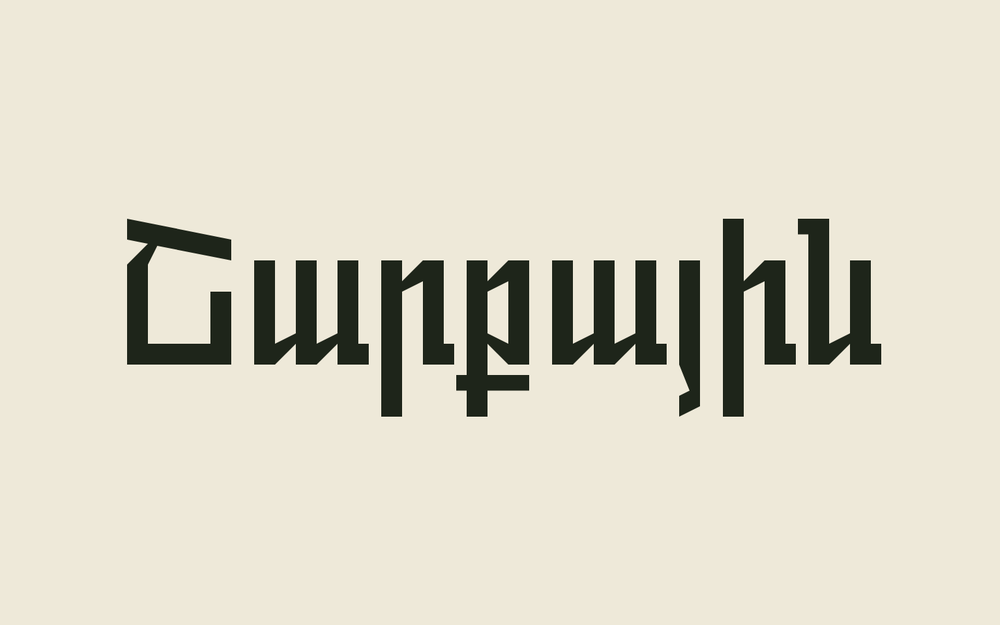

# Sharqayin

**Sharqayin** (Շարքային) is an Armenian variable typeface by Hamlet Petrosyan. It has a single weight axis from Regular to Black, six named instances, and a compact Armenian character set.

> **Live specimen:** `https://YOUR-USERNAME.github.io/YOUR-REPO/` — replace after enabling GitHub Pages.



## Details

| | |
|---|---|
| Family | Sharqayin |
| Designer | Hamlet Petrosyan |
| Version | 1.000 |
| Variable axis | `wght` 400–900 |
| Instances | Regular 400 · Medium 500 · Semi Bold 600 · Bold 700 · Extra Bold 800 · Black 900 |
| Formats | Variable TT, static TTF/OTF, WOFF2 |
| Coverage | 94 designed symbols: 38 capitals, 39 lowercase, 10 digits, 6 marks, space |
| License | SIL Open Font License 1.1 |

The variable font includes `STAT`, `HVAR` and `gvar` data.

## Download

- **Variable font:** [`Variable-TT/Sharqayin-Regular-VF.ttf`](Variable-TT/Sharqayin-Regular-VF.ttf)
- **Complete package:** [`docs/downloads/Sharqayin-v1.000.zip`](docs/downloads/Sharqayin-v1.000.zip)
- **Static TrueType:** [`OpenType-TT/`](OpenType-TT/)
- **Static OTF + WOFF2:** [`Web-PS/`](Web-PS/)
- **FontLab source:** [`Sharqayin-Regular.vfc`](Sharqayin-Regular.vfc)
- **Specimen site font:** [`docs/fonts/Sharqayin-Regular-VF.ttf`](docs/fonts/Sharqayin-Regular-VF.ttf)

## Repository layout

```text
Sharqayin/
├── Sharqayin-Regular.vfc      FontLab 8 source
├── Variable-TT/               variable font export
├── OpenType-TT/               static TrueType exports
├── Web-PS/                    static OTF + WOFF2 exports
├── DesignSpace-UFO/           designspace + UFO export
├── docs/                      specimen website (GitHub Pages source)
│   ├── index.html
│   ├── styles.css
│   ├── app.js
│   ├── .nojekyll
│   ├── fonts/
│   │   ├── embedded-font.css
│   │   ├── site-font.js
│   │   ├── Sharqayin-Regular-VF.ttf
│   │   └── OFL.txt
│   └── downloads/
│       └── Sharqayin-v1.000.zip
├── specimen/                  preview image
├── tools/                     inspect, embed and release helpers
├── OFL.txt
├── LICENSE                    MIT (website code and tooling)
├── FONTLOG.txt
├── RELEASE.md
└── README.md
```

## Build and update

The source is `Sharqayin-Regular.vfc` (FontLab 8). After re-exporting the font:

```bash
python tools/embed_font.py
python tools/build_release.py
```

`embed_font.py` regenerates the site’s embedded font, its metadata and the web download. `build_release.py` rebuilds `docs/downloads/Sharqayin-v1.000.zip`.

Inspect axes, instances and coverage with:

```bash
python tools/inspect_font.py Variable-TT/Sharqayin-Regular-VF.ttf
```

Requires Python 3.11+. See [`RELEASE.md`](RELEASE.md) before publishing.

## Specimen website

`docs/` is a static site with a live bordered weight specimen, six instances, the available symbols, an editable playground, theme switching and downloads. The variable font is embedded in the CSS, so the page also works offline:

```bash
# open docs/index.html directly, or:
cd docs
python -m http.server 8000
```

### Push to GitHub

1. Create an empty **public** repository at [github.com/new](https://github.com/new). Name it `Sharqayin`; do not add a README, `.gitignore` or license.
2. From this folder:

```bash
git remote add origin https://github.com/<username>/Sharqayin.git
git push -u origin main
git push origin v1.000
```

Use the actual repository URL if you choose another name. Git will prompt for GitHub authentication if needed.

3. After Pages is live, replace the `YOUR-USERNAME` / `YOUR-REPO` placeholder at the top of this README with the published URL and commit the change.

### GitHub Pages

1. Open **Settings → Pages**.
2. Choose **Deploy from a branch**.
3. Select **main** and **/docs**.
4. Save. The site will be published at `https://<username>.github.io/Sharqayin/`.

`.nojekyll` is included in `docs/`. Add a `CNAME` there for a custom domain.

### GitHub Release

1. Open **Releases → Draft a new release**.
2. Choose the existing tag **v1.000**, target **main**.
3. Title it **Sharqayin v1.000**.
4. Attach [`docs/downloads/Sharqayin-v1.000.zip`](docs/downloads/Sharqayin-v1.000.zip).
5. Publish the release.

## AI disclosure

The interface copy and documentation in this repository (README, FONTLOG and release checklist) were generated with AI assistance. The typeface, font files, and the Armenian specimen passage were supplied by Hamlet Petrosyan.

## License

- **Font:** SIL Open Font License 1.1 — [`OFL.txt`](OFL.txt). The license is also embedded in the font metadata and copied to [`docs/fonts/OFL.txt`](docs/fonts/OFL.txt).
- **Website code and tooling:** MIT — [`LICENSE`](LICENSE).

If you want to reserve the name, add `with Reserved Font Name "Sharqayin"` to the copyright line in `OFL.txt` and the font metadata before release.

## Credits

Typeface and specimen: Hamlet Petrosyan.

Website UI type: [Switzer](https://fontshare.com/fonts/switzer) by Indian Type Foundry, served through the Fontshare API. The page falls back to the system sans-serif if the API is unavailable.
